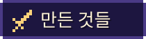
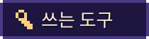
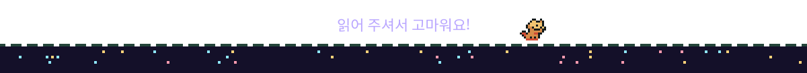

안녕하세요, 이동현이에요.

게임이랑 데스크톱 앱을 만들어요. 혼자 만들다 보니 늘 손이 모자라서, 요즘은 AI 에이전트 여러 명한테 일을 나눠 주고 같이 개발하는 방법을 이것저것 실험하고 있어요. 그러다 필요한 도구가 없어서 직접 만든 게 아래 AITermHub예요.

 

### 마나 흐름

탑다운 2D 액션 RPG예요. 적 공격 직전에 막는 패링이랑 아슬아슬하게 피하는 완벽 회피에 손맛을 넣는 데 신경을 제일 많이 썼어요. 싸우다 지치면 낚시하고, 모닥불에서 밥 해 먹고, 집도 지을 수 있어요. 시점을 돌려서 2.5D나 1인칭으로 보는 것도 해 봤고요. 지금 v1.7까지 왔어요.

Unity 6 · URP 2D · C# &nbsp;|&nbsp; Windows · Android &nbsp;|&nbsp; 코드 비공개 
그래픽은 Ninja Adventure 에셋(CC0)을 썼어요.

 

### AITermHub

Claude Code랑 Codex를 한 창에 탭으로 모아 두고, 한 프로젝트를 여러 에이전트가 나눠서 동시에 만들게 하는 앱이에요. 위 화면은 에이전트 네 명이 마나 흐름을 같이 고치는 중이에요. 각자 맡은 폴더가 있고, 남의 담당 파일을 건드리면 빨갛게 알려 줘요.

쉬고 있는 에이전트는 메모리를 거의 0까지 내려놔요. 프로세스를 끄는 대신 재워 두는 방식이라, 다시 말을 걸어도 대화를 처음부터 다시 읽느라 토큰이 새지 않아요. 이 부분 찾느라 꽤 헤맸어요.

Tauri 2 · Rust · Svelte 5 · TypeScript &nbsp;|&nbsp; 코드 비공개

 

### DeskMate

과제 마감 확인하려고 매번 학교 이클래스에 들어가는 게 귀찮아서 만들었어요.

바탕화면에 조용히 붙어 있다가, 마감이 다가오면 점점 자주 알려 줘요. 로그인이 풀려 있으면 알아서 다시 로그인하고, 비밀번호는 Windows 자격 증명에만 넣어 둬요.

공부할 때 쓰는 포모도로, D-day, 메모도 같이 넣었어요.

Tauri 2 · Rust · SvelteKit · SQLite

 
 

 

backha.candy0101@gmail.com 으로 편하게 연락 주세요.

English

 

Hi, I'm 이동현 (Backhacandy). I make games and desktop apps, and lately I've been experimenting with splitting work across several AI coding agents so they can build one project together.

**ManaFlow** is a top-down 2D action RPG made with Unity 6. I put the most care into making parries and perfect dodges feel good. There's also fishing, cooking and building, plus 2.5D and first-person camera modes. Currently at v1.7. The art uses the Ninja Adventure pack (CC0).

**AITermHub** puts Claude Code and Codex in tabs and lets several agents work on the same project at once, each owning its own paths. Idle agents are suspended rather than killed, so memory drops to almost zero without losing the prompt cache. Built with Tauri 2, Rust and Svelte 5.

**DeskMate** is a desktop widget that pulls assignments and deadlines from my university's e-class and reminds me more often as deadlines get closer. It re-logs in on its own and keeps the password in the Windows credential store. Built with Tauri 2, Rust and SQLite.

Contact: backha.candy0101@gmail.com

 

