


 



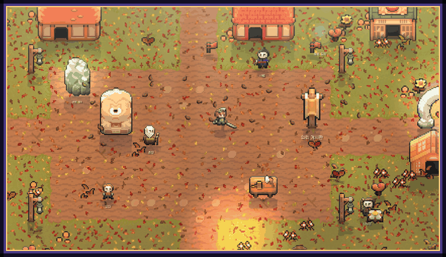

탑다운 2D 액션 RPG예요. 적이 휘두르기 직전에 막는 패링, 아슬아슬하게 피하는 완벽 회피에 손맛을 넣는 데 제일 공을 들였어요. 싸우다 지치면 낚시하고, 모닥불에서 밥 해 먹고, 집도 지을 수 있어요. 시점을 돌려 2.5D나 1인칭으로 보는 것도 해 봤고요.

Unity 6 · URP 2D · C# &nbsp;|&nbsp; Windows · Android &nbsp;|&nbsp; 코드 비공개 &nbsp;|&nbsp; 그래픽 Ninja Adventure(CC0)

 


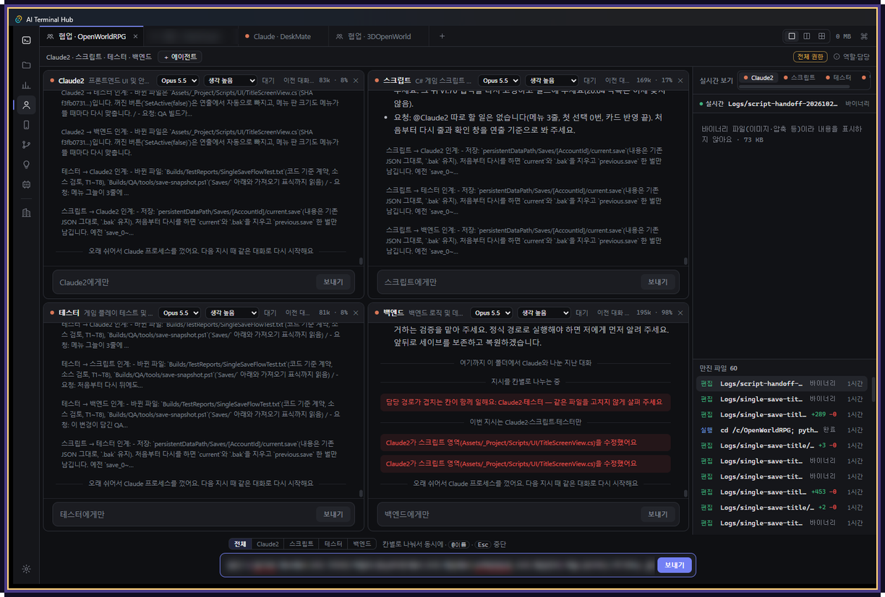

위 마나 흐름도 사실 이걸로 만들고 있어요. Claude Code랑 Codex를 한 창에 탭으로 모아 두고, 한 프로젝트를 에이전트 여러 명이 나눠서 동시에 작업하게 해요. 화면은 넷이서 마나 흐름을 고치는 중인 모습이에요. 각자 맡은 폴더가 있고, 남의 담당 파일을 건드리면 빨갛게 알려 줘요.

쉬는 에이전트는 메모리를 거의 0까지 내려놓는데, 프로세스를 끄지 않고 재워 두는 방식이라 다시 말을 걸어도 토큰이 새지 않아요.

Tauri 2 · Rust · Svelte 5 · TypeScript &nbsp;|&nbsp; 코드 비공개

 


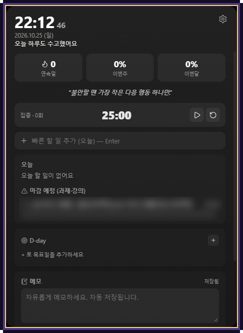

과제 마감 확인하려고 매번 학교 이클래스에 들어가는 게 귀찮아서 만들었어요.

바탕화면 구석에 조용히 붙어 있다가, 마감이 다가오면 점점 자주 알려 줘요. 로그인이 풀려 있으면 알아서 다시 로그인하고, 비밀번호는 Windows 자격 증명에만 넣어 둬요.

공부할 때 쓰는 포모도로, D-day, 메모도 같이 들어 있어요.

Tauri 2 · Rust · SvelteKit · SQLite &nbsp;|&nbsp; 코드 비공개

 
 


 


궁금한 거나 같이 해 보고 싶은 게 있으면 편하게 보내 주세요 <b>backha.candy0101@gmail.com</b>

English

 

Hi, I'm 이동현 (Backhacandy). I make games and desktop apps, and lately I've been figuring out how to split work across several AI coding agents so they can build one project together.

**ManaFlow** is a top-down 2D action RPG made with Unity 6. I put the most care into making parries and perfect dodges feel good. There's also fishing, cooking and building, plus 2.5D and first-person camera modes. Currently at v1.7. Art uses the Ninja Adventure pack (CC0).

**AITermHub** is what I actually use to build ManaFlow. It puts Claude Code and Codex in tabs and lets several agents work on the same project at once, each owning its own paths. Idle agents are suspended rather than killed, so memory drops to almost zero without losing the prompt cache.

**DeskMate** is a desktop widget that pulls assignments and deadlines from my university's e-class and reminds me more often as deadlines get closer.

Code for these projects is private. Feel free to reach out: backha.candy0101@gmail.com

